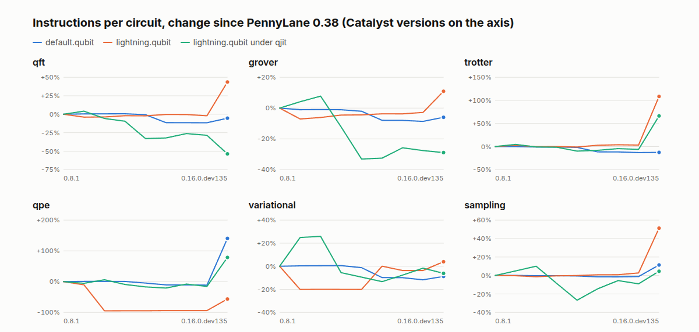

# pennywatch

An independent performance history of [PennyLane](https://github.com/PennyLaneAI/pennylane),
[Lightning](https://github.com/PennyLaneAI/pennylane-lightning) and
[Catalyst](https://github.com/PennyLaneAI/catalyst). The same circuits run on every build, and when a
cost changes, it finds the pull request behind it.

**[See the history](https://amirradjou.github.io/pennywatch/)**



## What it has found

| Change | Size | Cause | Checked by |
|---|---:|---|---|
| Importing PennyLane, since 0.43 | +74% | One line, `from scipy.stats import multinomial`, used by one function ([#7988](https://github.com/PennyLaneAI/pennylane/pull/7988)) | Removing it gives back 87% of the rise |
| `qpe/default`, on dev builds | +171% | `QFT` lost the cache on its matrix when it moved to `Operator2` ([#9932](https://github.com/PennyLaneAI/pennylane/pull/9932)) | Adding it back halves the cost |
| `qpe/lightning`, on dev builds | +622% | Operators moving to `Operator2`, mostly `PhaseShift` ([#9951](https://github.com/PennyLaneAI/pennylane/pull/9951)) | Bisecting, commit by commit |
| `trotter/lightning`, on dev builds | +102% | `qp.prod` moving to `Prod2` ([#10113](https://github.com/PennyLaneAI/pennylane/pull/10113)), and three smaller ones | Bisecting, commit by commit |
| `default.qubit` cells, at 0.43 | -11% | numpy 2.4, and not PennyLane at all | Changing only numpy on the older stack |
| Lightning's peak memory, at 0.41 | -44% | Expectation values computed in place, not on a copy of the state ([#1079](https://github.com/PennyLaneAI/pennylane-lightning/pull/1079)) | Swapping only Lightning, both ways round |
| `qpe/lightning`, at 0.40 | -94% | Lightning keeping controlled powers whole, not expanding them ([#988](https://github.com/PennyLaneAI/pennylane-lightning/pull/988)) | Reading the code, since it can't be bisected |

The dev builds are mid-migration and these aren't released yet, so that part of the history may well change.

Details and raw numbers are in [findings](docs/findings.md), and every explanation it has given,
including the wrong ones, is in [explanations](docs/explanations.md).

## Try it

You need Docker and [uv](https://docs.astral.sh/uv/).

```sh
git clone https://github.com/amirradjou/pennywatch && cd pennywatch
uv run pennywatch run --suite full --cells qft/lightning --repeats 1 --no-busy-check
```

That measures one real circuit. The first run builds the image and installs a stack, which takes a few
minutes and about 2 GiB, and it ends with a table of what it found. Then:

```sh
uv run pennywatch run --suite full --cells qft/lightning --stack 0.14.1      # any release, or dev build
uv run pennywatch steps results/stable/*.json                                # what changed between releases
uv run pennywatch explain 0.12.0 0.13.0 --cell qft/default                   # what caused one of them
```

## How it works

- **It counts instructions, not time.** Each circuit runs under Valgrind, single-threaded, in a pinned
  container. On a busy machine the count moved 0.004% while wall-clock time got 3.5 times slower.
- **It runs each circuit under several memory layouts.** Adding 16 bytes to an environment variable
  moved one count by 0.58%, with the same code on the same machine. So a figure is the median across
  layouts, and a change only counts if the runs of the two builds are apart. GitHub's runners then agree
  to within 0.28% across AMD and Intel.
- **Every run proves itself.** Each circuit's answer has to be right, checked against something other
  than PennyLane, and a canary with 1% extra gates has to show up. Otherwise the build is thrown out.
- **It narrows a change down.** PennyLane is pure Python, so it gets bisected commit by commit. Lightning
  and Catalyst are too slow to build per commit, so those stop at a list of candidates and say so. After
  each night, the newest changes are measured again on a fresh runner and explained without anyone asking.

It can't see cache misses, GPUs, multi-threading or effects that only appear at scale, so it complements
real timing and doesn't replace it. More in [the plan](docs/PLAN.md#limits).

## More

[Commands](docs/GUIDE.md) · [Plan and milestones](docs/PLAN.md) · [Findings](docs/findings.md) ·
[Explanations](docs/explanations.md) · [All the steps](docs/HISTORY.md)

MIT. Not affiliated with or endorsed by Xanadu, who make PennyLane, Lightning and Catalyst and already
benchmark them. Nothing in this repo posts to their repositories; anything reported upstream is written
by a person, as [their AI policy](https://github.com/PennyLaneAI/pennylane/blob/master/AI_Policy.md)
asks.
